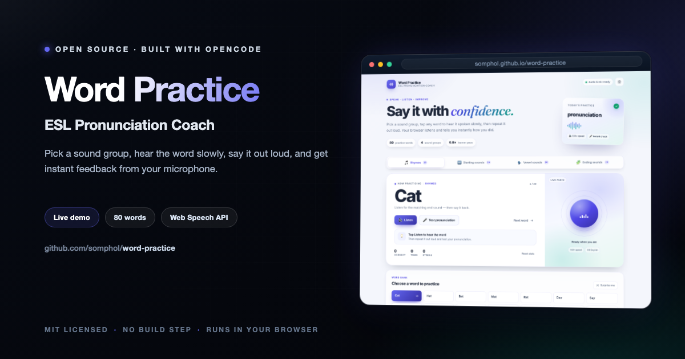

<div align="center">



# Word Practice

**ESL Pronunciation Coach**

Pick a sound group, hear a word spoken slowly, say it out loud, and get instant feedback from your microphone.

[](https://somphol.github.io/word-practice/)
[](LICENSE)

**[Try it live →](https://somphol.github.io/word-practice/)**

</div>

---

## Features

- **80 curated words across four sound groups** — rhymes, starting consonants and blends, vowel sounds, and ending sounds and blends. Every category has exactly 20 words.
- **Learner-paced audio** — the browser's native `SpeechSynthesisUtterance` API speaks each word at `rate = 0.8`, in US English.
- **Instant pronunciation check** — the native `SpeechRecognition` / `webkitSpeechRecognition` API listens once, compares what you said with the target word, and shows a green check or a red cross with the words it heard.
- **Clear, friendly feedback** — large targets, high-contrast states, live-region announcements, and a sound orb that reacts to listening, speaking, success, and mistakes.
- **Practice stats** — correct answers, total tries, and current streak are saved locally in your browser.
- **Light and dark themes** — follows your system preference on the first visit and remembers your choice.
- **Keyboard friendly** — `L` listens, `T` tests, `N` picks the next word, arrow keys move between tabs and word cards.
- **Responsive** — designed for phones, tablets, and desktops.
- **No build step, no dependencies, no tracking** — three files and a favicon, ready for GitHub Pages.

## Word groups

| Group | Focus | Words |
| --- | --- | --- |
| 🎵 Rhymes | Matching end sounds | Cat, Hat, Bat, Mat, Rat, Day, Say, Play, Ray, Way, Light, Night, Bright, Sight, Flight, Cold, Hold, Bold, Gold, Told |
| 🔤 Starting sounds | Initial consonants and blends | Blue, Chair, Fast, Green, House, Jump, Kite, Light, Mouse, Nest, Play, Quick, Read, Smile, Train, Voice, Water, Yellow, Zebra, Sheep |
| 🗣️ Vowel sounds | Short and long vowels | Cat, Cake, Bed, Bee, Pig, Bike, Pot, Bone, Cup, Tube, Map, Rain, Net, Tree, Sit, Light, Hot, Boat, Bus, Moon |
| 🧩 Ending sounds | Final consonants and blends | Bank, Fast, Hand, Milk, Jump, Desk, Camp, Tent, Bulb, Wolf, Nest, Risk, Pond, Gift, Belt, Lamp, Sand, Task, Pink, Salt |

## How the pronunciation check works

1. Click **Listen** or any word card. The browser speaks the word at 0.8× speed.
2. Click **Test pronunciation**. The app asks for microphone access and listens for one short response.
3. The transcript is normalized (case, punctuation, and extra spaces are ignored) and compared with the target word. Common phrases such as “the cat” are accepted as long as the full target word is present.
4. You get instant feedback: ✅ with your transcript, or ❌ with what was heard and a prompt to try again.

Speech recognition is handled entirely by the browser's Web Speech API. This app does not record, upload, or store audio.

## Browser support

| Browser | Audio (TTS) | Microphone check (STT) |
| --- | --- | --- |
| Chrome / Edge (desktop) | ✅ | ✅ |
| Safari (macOS / iOS) | ✅ | ✅ |
| Firefox | ✅ | ❌ (API not available) |
| Chrome on Android | ✅ | ✅ |

The microphone check requires a secure context (`https://` or `localhost`) and microphone permission. Chrome's speech recognition may require a network connection because the browser uses its own online speech service.

## Run locally

No build tools are needed. Because microphone access requires a secure context, serve the folder over localhost rather than opening the file directly:

```bash
cd word-practice
python3 -m http.server 8000
```

Then open <http://localhost:8000>.

## Project structure

```
word-practice/
├── index.html      # Semantic app shell, tabs, practice panel, and word-grid container
├── style.css       # Soft indigo/slate design system, animations, and responsive layouts
├── script.js       # Word data, tab logic, speech synthesis, recognition, and stats
├── favicon.svg     # Custom app icon
├── screenshot.png  # README preview
├── README.md
├── STATE.md        # Build duration and token usage
├── state.json      # Machine-readable build record
└── LICENSE
```

## Privacy

Word Practice has no backend, accounts, cookies, or analytics. Theme choice and practice stats live in `localStorage` and never leave your device. Your browser's speech engine processes audio according to that browser vendor's policies; this app itself never stores a recording.

## Build state & credits

This project was generated in a single agent session. See [STATE.md](STATE.md) for the build duration and token usage, and [state.json](state.json) for the machine-readable record.

Built with [OpenCode](https://opencode.ai) and **DeepSeek V4.1 Flash**.

## License

[MIT](LICENSE) © 2026 Somphol Boonjing
